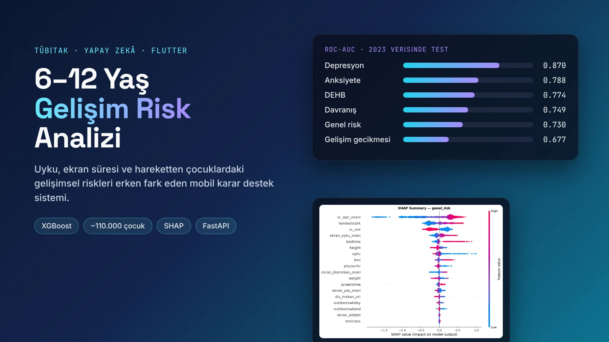
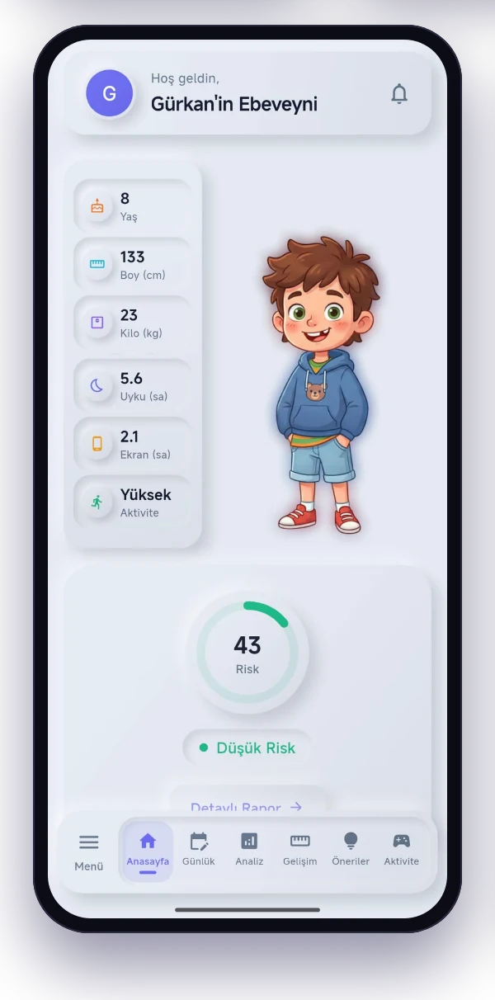
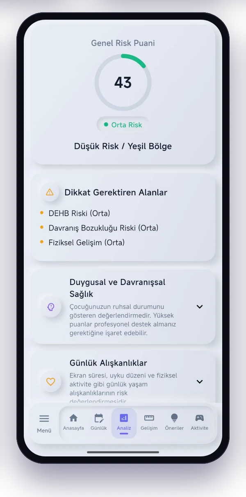
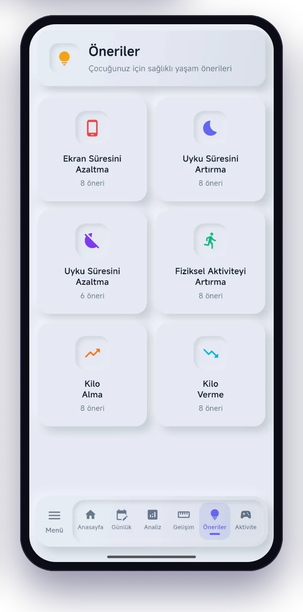
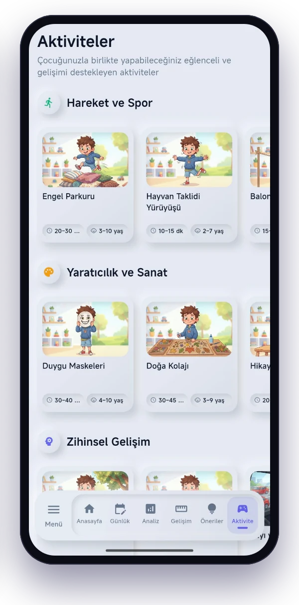
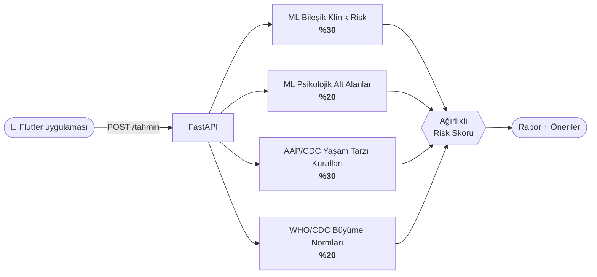
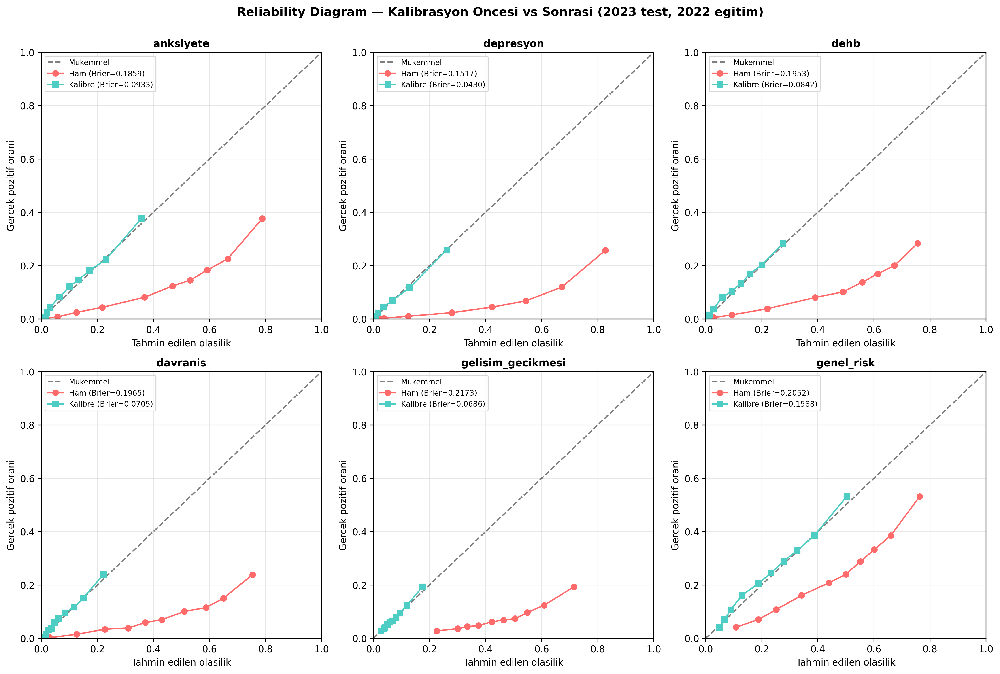
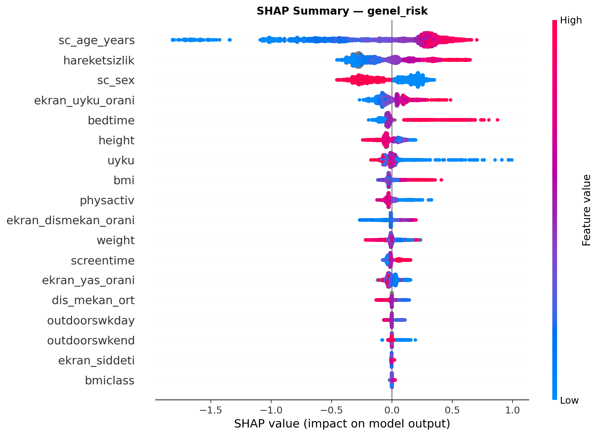
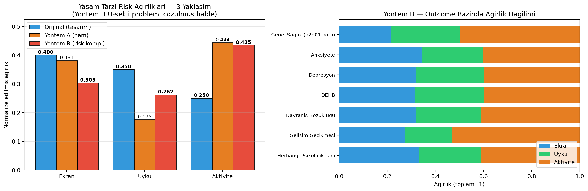

<div align="center">

# 🧒 6–12 Yaş Çocuk Gelişim Risk Analizi

**Uyku, ekran süresi, fiziksel aktivite ve büyüme verilerinden çocuklardaki gelişimsel ve psikolojik riskleri erken fark eden, yapay zekâ destekli mobil karar destek sistemi.**

<sub>TÜBİTAK projesi</sub>

<br>


</div>

<p align="center">
  
</p>

---

> [!IMPORTANT]
> Bu uygulama bir **ön tarama ve farkındalık aracıdır**, tıbbi teşhis koymaz. Yüksek risk sonucu, bir çocuk sağlığı uzmanına danışmak için bir işarettir.

## 💡 Fikir

Ebeveynler çocuklarının uykusunu, ekran süresini ve hareketini her gün görüyor, ama bu alışkanlıkların riske dönüşüp dönüşmediğini bilmiyor. Bu proje, **telefonla kolayca girilebilecek birkaç veriden**, bu alışkanlıkların çocuğun yaşıtlarına göre riskini **ne kadar artırdığını** hesaplıyor ve somut, yaşa uygun öneriler sunuyor.

## ✨ Özellikler

| | |
|---|---|
| 👨‍👩‍👧 **Çoklu çocuk profili** | Her çocuk için ayrı profil, geçmiş ve analizler |
| 📝 **Kısa analiz formu** | Yaş, cinsiyet, boy, kilo, uyku, ekran süresi, fiziksel aktivite, dışarıda geçen süre |
| 📊 **Risk raporu** | Genel risk ve 5 alt alan: anksiyete, depresyon, DEHB, davranış, gelişim gecikmesi |
| 📈 **Büyüme takibi** | Boy ve kilo kayıtları; WHO/CDC büyüme normlarına göre z-skoru ile obezite, zayıflık ve boy kısalığı değerlendirmesi |
| 🗓️ **Günlük kayıt** | Uyku, ekran süresi ve fiziksel aktiviteyi gün gün izleme |
| 🎯 **Öneriler ve aktiviteler** | Ekran, uyku, aktivite ve kilo için kategorili öneriler; Hareket ve Spor, Yaratıcılık ve Sanat, Zihinsel Gelişim başlıklarında yaşa uygun aktiviteler |

## 📱 Uygulama Ekranları

<table>
  <tr>
    <td width="25%"></td>
    <td width="25%"></td>
    <td width="25%"></td>
    <td width="25%"></td>
  </tr>
  <tr>
    <td align="center"><sub><b>Ana sayfa</b><br>Çocuğun özeti ve risk puanı</sub></td>
    <td align="center"><sub><b>Analiz</b><br>Genel risk ve dikkat gerektiren alanlar</sub></td>
    <td align="center"><sub><b>Öneriler</b><br>6 kategoride sağlıklı yaşam önerileri</sub></td>
    <td align="center"><sub><b>Aktiviteler</b><br>Yaşa uygun, süreli etkinlik kartları</sub></td>
  </tr>
</table>

Arayüz yumuşak, nöromorfik bir tasarım diliyle hazırlandı; çocuk figürü ve aktivite illüstrasyonları uygulamaya sıcak bir karakter katıyor.

## 🧠 Yapay Zekâ: 4 Katmanlı Hibrit Risk Motoru

Saf makine öğrenmesi, "günde 8 saat ekran, 4 saat uyku" girdisinin tehlikeli olduğunu her zaman anlamaz. Bu yüzden sistem, istatistiksel modelleri **klinik kılavuz kurallarıyla** birleştiriyor:



- **Veri:** ABD Ulusal Çocuk Sağlığı Anketi (**NSCH**) 2022 ve 2023, yaklaşık **110.000** çocuk.
- **Hedefler:** Doktor tanısına dayalı 5 klinik etiket ve bunları kapsayan bir **genel risk** modeli.
- **Model:** XGBoost. Dengesiz sınıflar için `scale_pos_weight` uygulandı. **Optuna** ile 1.500'den fazla denemelik hiperparametre araması yapıldı. Olasılıkları gerçekçi kılmak için **sigmoid kalibrasyon** eklendi.
- **Göreli risk:** Yaşın doğal etkisi ayıklanıyor. Çocuğun mevcut alışkanlıklarıyla hesaplanan risk, *ideal alışkanlıklarla* hesaplanan riskle karşılaştırılıyor. Ortaya çıkan fark, yalnızca alışkanlıkların yarattığı **ek risk** oluyor.
- **Özellik mühendisliği:** `ekran_uyku_orani`, `hareketsizlik_indeksi`, `ekran_yas_orani`.

## 📏 Performans

Modeller **2022 verisiyle eğitilip 2023 verisinde test edildi** (temporal validasyon, %95 bootstrap güven aralığıyla):

| Model | ROC-AUC | Recall | Brier iyileşmesi (kalibrasyon) |
|---|:-:|:-:|:-:|
| Depresyon | **0.870** | 0.477 | %71.6 |
| Anksiyete | **0.788** | 0.573 | %49.8 |
| DEHB | **0.774** | 0.561 | %56.9 |
| Davranış bozukluğu | **0.749** | 0.438 | %64.1 |
| Gelişim gecikmesi | **0.677** | 0.378 | %68.4 |
| **Genel risk** | **0.730** | **0.722** | %22.6 |

Genel risk modeli, tanılı çocukların **yaklaşık %72'sini** yalnızca mobil girdilerle "yüksek risk" olarak yakalıyor. Bu, bir ön tarama aracı için hedeflenen düzey.

<table>
  <tr>
    <td width="60%"></td>
    <td width="40%"></td>
  </tr>
  <tr>
    <td align="center"><sub>Kalibrasyon: tahmin edilen ve gözlenen olasılıklar</sub></td>
    <td align="center"><sub>SHAP: genel riski en çok etkileyen özellikler</sub></td>
  </tr>
</table>

<details>
<summary><b>Yaşam tarzı ağırlıkları veriden nasıl türetildi?</b></summary>
<br>

Başlangıçta elle seçilen ekran / uyku / aktivite ağırlıkları (0.40 / 0.35 / 0.25), NSCH verisinde standartlaştırılmış lojistik regresyonla yeniden hesaplandı. Üretimde kullanılan değerler **ekran 0.30 · uyku 0.26 · aktivite 0.44** oldu; yani fiziksel aktivite beklenenden daha belirleyici çıktı.

<p align="center"></p>

Ayrıntılı rapor: [`analiz/sonuclar/RAPOR.md`](analiz/sonuclar/RAPOR.md) · Geliştirme süreci: [`yapay_zeka_model_raporu.md`](yapay_zeka_model_raporu.md)

</details>

## 🔌 API

```http
POST /tahmin
Content-Type: application/json

{
  "yas": 9, "cinsiyet": 0,
  "uyku_saati": 8.5, "ekran_saati": 3,
  "boy_cm": 132, "kilo_kg": 29,
  "fiziksel_aktivite": 1,
  "dis_mekan_dk_hafta_ici": 45, "dis_mekan_dk_hafta_sonu": 120
}
```

`cinsiyet`: 0 erkek, 1 kız · `fiziksel_aktivite`: 0 düşük, 1 orta, 2 yüksek

## 🚀 Çalıştırma

**Backend (Python 3.10+)**

```bash
pip install -r requirements.txt
uvicorn app:app --reload --port 8001
```

**Mobil uygulama (Flutter, Dart 3.8+)**

```bash
cd risk_analizi_app
flutter pub get
flutter run
```

Android emülatöründe uygulama yerel API'ye `10.0.2.2:8001` üzerinden bağlanır. Yayındaki API adresi `lib/services/api_service.dart` içinde tanımlı.

## 🗂️ Proje Yapısı

```
├── app.py                  # FastAPI uygulaması (/tahmin)
├── risk_engine.py          # 4 katmanlı hibrit risk motoru
├── growth_norms.py         # WHO/CDC büyüme eğrileri (LMS, z-skoru)
├── optimize_models.py      # Optuna hiperparametre optimizasyonu
├── nsch_*_model.pkl        # Eğitilmiş ve kalibre edilmiş modeller
├── analiz/                 # Temporal validasyon, bootstrap, kalibrasyon, SHAP
│   └── sonuclar/           # Grafikler ve RAPOR.md
└── risk_analizi_app/       # Flutter mobil uygulaması
    └── lib/
        ├── screens/        # Profil, analiz formu, sonuç, rapor, büyüme, günlük kayıt, öneriler, aktiviteler
        ├── services/       # API ve yerel depolama
        └── models/         # Çocuk profili, büyüme kaydı, günlük kayıt
```

## 👨‍💻 Geliştirici

**Gürkan Gürdal** · [@GurkanGurdal](https://github.com/GurkanGurdal)
